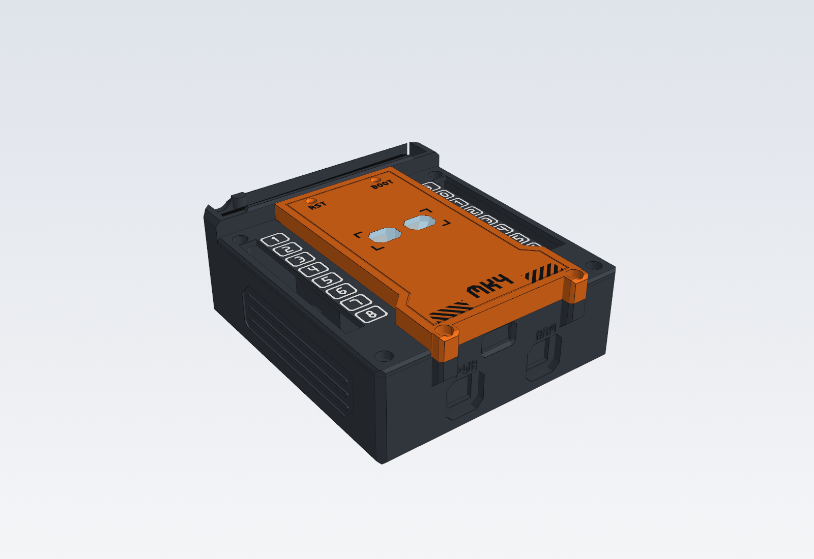
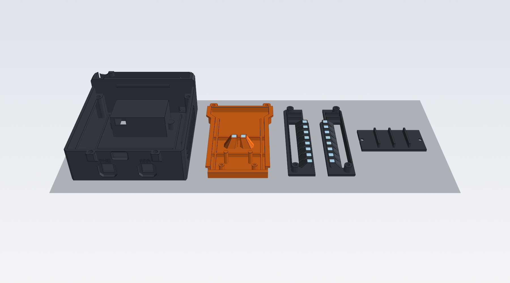
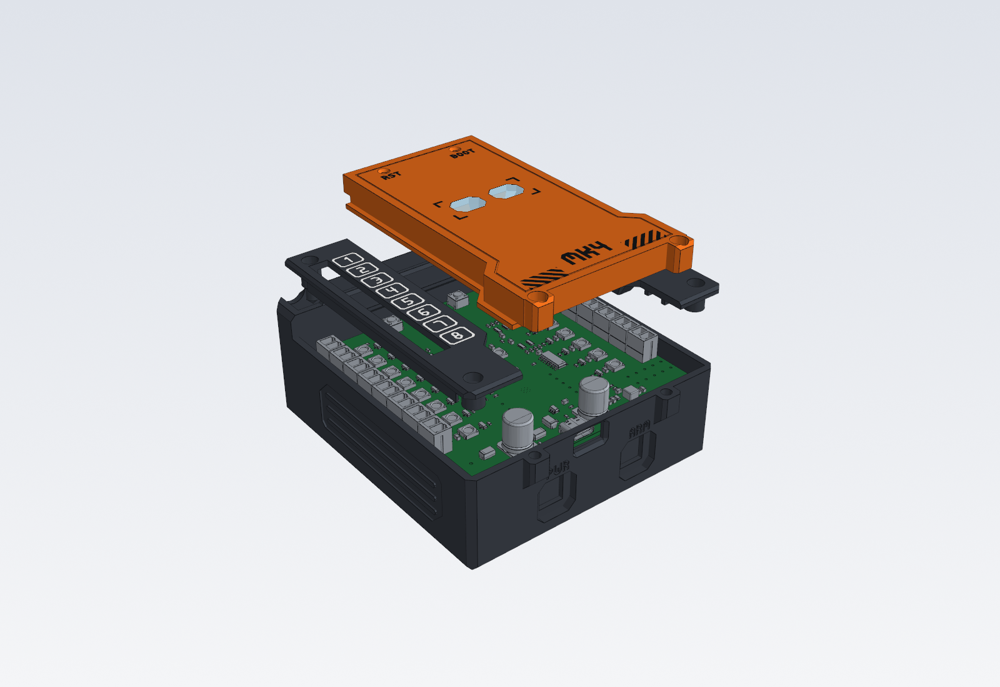
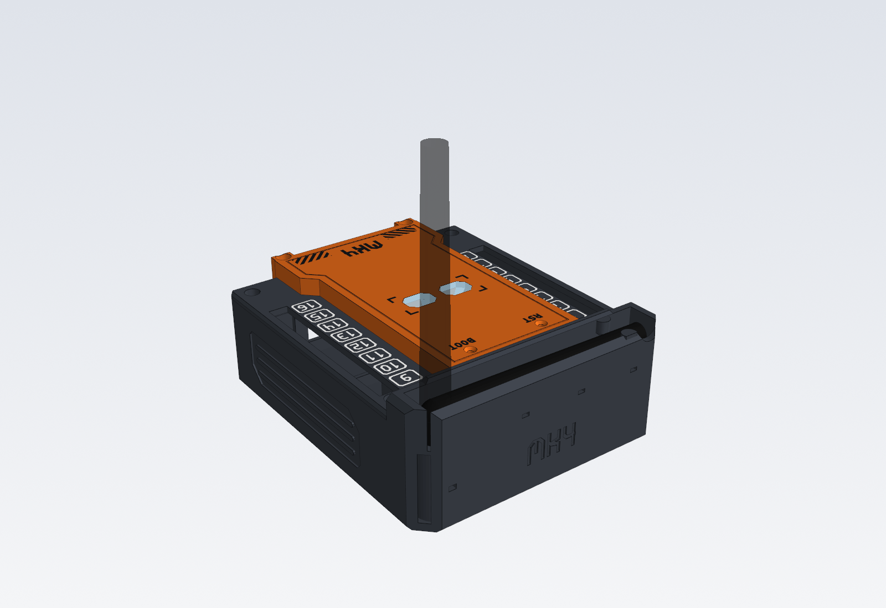
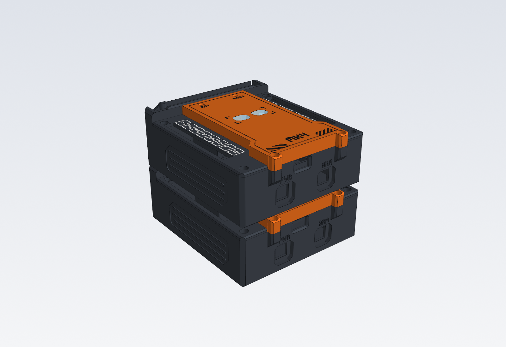
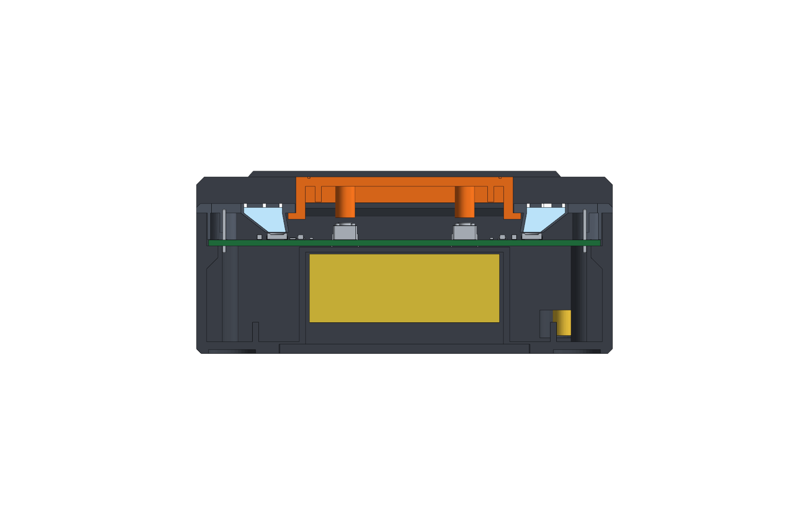

# MK4 Zündanlage – 3D-druckbares Gehäuse



Modulares Gehäuse für die MK4-Proto-Platine (100 × 100 mm). Alle Teile sind ohne Stützmaterial druckbar und mit M3-Schrauben und Einschmelzmuttern verschraubt.

| | |
|---|---|
| Außenmaße | 106,2 × 123,4 × 45,1 mm (128 mm tief inkl. Schraublaschen vorne, 46,6 mm hoch inkl. Stapelleiste) |
| Stapelraster | 45,1 mm (Leiste oben greift in Nut unten) |
| Klemmen | Oberkante bündig mit den Seitenpaneelen (`CONN_PROTRUDE = 0`) |
| Kanalnummern | 1–8 links (BANK A), 9–16 rechts (BANK B), leuchtend, mit eckigem Rahmen |
| Status-LEDs | D409/D410 mit aufweitendem Lichtleiter (4,4 mm → 12 × 9 mm Streulinse) |
| Schalter | 2 × Ausschnitt 10,2 × 10,2 mm vorne in 3 mm tiefen Schutzmulden (links POWER, rechts ARM) |
| Antenne | klappt bündig in eine Rinne in der hinteren Rückenleiste, Buchse senkrecht im Schacht hinten rechts |
| Batterie | 9-V-Block im Fach unter der Platine, Deckel unten (2 × M3) |

## Dateien

| Ordner | Inhalt |
|---|---|
| `3MF/` | **Druckfertig**, in Drucklage. Jedes Teil ist ein Objekt mit Unterteilen (Körper / Lichtleiter / Ziffern). `MK4_alle_Teile.3mf` enthält alle Teile nebeneinander. |
| `STEP/` | CAD-Daten in Einbaulage, ein STEP je Teil (Körper als benannte Solids) plus Baugruppe. `MK4_Gehaeuse_Baugruppe_mit_Platine.step` enthält zusätzlich das KiCad-3D-Modell der Platine (≈ 50 MB, ggf. nicht ins Git einchecken). |
| `STL/` | Fallback: eine STL je Körper in Drucklage. Zusammengehörige Dateien gemeinsam als ein Objekt mit mehreren Teilen laden. |
| `vorschau/` | Renderings und Schnittbilder |
| `quelle/` | Parametrisches Python-Skript (build123d), Neuerzeugung siehe unten |

## Teile und Druck



| Teil | Drucklage | Filamente | Stützen |
|---|---|---|---|
| 01 Unterteil | aufrecht, Boden aufs Bett | 1 (dunkel) | keine |
| 02 Haube | kopfüber, Oberseite aufs Bett | Körper (z. B. orange) + transparent (Status-Linsen) + optional Kontrastfarbe für Schrift/Warnstreifen | keine |
| 03 Seitenpaneel L (Kanal 1–8) | kopfüber, Ziffernseite aufs Bett | dunkel + transparent (Lichtleiter + Ziffern) | keine |
| 04 Seitenpaneel R (Kanal 9–16) | wie L | dunkel + transparent | keine |
| 05 Batteriedeckel | Außenseite aufs Bett | 1 (dunkel) | keine |

**Material:** PETG für alle Teile empfohlen (Außeneinsatz, Sonne). Lichtleiter aus transparentem PETG. Innerhalb eines Teils nicht PLA und PETG mischen, die beiden haften kaum aneinander. Wenn Sie PLA verwenden, dann auch transparentes PLA.

**Slicer (Bambu Studio / OrcaSlicer / PrusaSlicer):**
- 3MF öffnen. Jedes Teil erscheint als ein Objekt mit Unterteilen, das Filament wird je Unterteil zugewiesen: `*_Koerper` → dunkel bzw. Haubenfarbe, `*_Lichtleiter_transparent` → transparent, `*_Ziffern_transparent` → transparent (oder weiß/natur für diffusere Ziffern), `Haube_Beschriftung_Kontrastfarbe` → schwarz (oder Körperfarbe, dann unsichtbar).
- Lichtleiter-Unterteile: 100 % Füllung, langsam drucken (≈ 30–50 mm/s) und etwa 10 °C heißer, dann werden sie klarer.
- Die Ziffern liegen in den ersten 1,0 mm (5 Schichten à 0,2 mm). Glatte PEI-Platte ergibt glänzende, texturierte eine matte Oberfläche.
- Schichthöhe 0,2 mm, für Paneele und Haube gern 0,16 mm. 3–4 Wandlinien, 20–25 % Füllung (Gyroid). Prime-Tower verwenden.

## Kaufteile

| Anzahl | Teil | Verwendung |
|---|---|---|
| 8 | Einschmelzmutter M3 (Bohrung Ø 4,0 × 6,5 mm, z. B. Ruthex M3×5,7) | 4 × Platinen-Eckpfosten, 2 × Laschen vorne, 2 × Batteriedeckel |
| 6 | M3×12 Zylinderkopf (ISO 4762) | 4 × Seitenpaneele (durch Platine in die Eckpfosten), 2 × Haube vorne |
| 2 | M3×8 Senkkopf (ISO 10642) | Batteriedeckel |
| 2 | Schalter für 10 × 10 mm Ausschnitt | POWER, ARM (Wand am Schalter 1,8 mm, ≈ 30 mm Bautiefe frei) |
| 1 | 2,4-GHz-Antenne RP-SMA + U.FL-Pigtail mit Einbaubuchse | AliExpress-Set |
| 1 | 9-V-Batterieclip | an BT201 |
| 4 | Gummifüße Ø 12 mm, max. 2,5 mm hoch (optional) | Mulden im Boden, stören das Stapeln nicht |

## Montage



1. **Einschmelzmuttern** setzen: 4 in die Eckpfosten (von oben), 2 in die Laschen vorne (von oben), 2 für den Batteriedeckel (von unten).
2. **Schalter** von außen einrasten: POWER links, ARM rechts. Litzen anlöten oder mit Flachsteckern anschließen.
3. **Antennenbuchse:** durch das Kabelfenster unter dem Schacht (hinten rechts, von innen) von unten durch das Ø-6,6-mm-Loch stecken. Scheibe und Mutter oben im Schacht anziehen. Mit den beiden Muttern der Buchse die Höhe so einstellen, dass die eingeklappte Antenne in der Rinne liegt.
4. **Batterieclip:** Litzen-Enden durch den Schlitz in der Vorderwand des Batteriefachs führen und später von unten durch BT201 stecken.
5. **Platine** einsetzen: Schalterlitzen und Batterielitzen von unten durch SW201, SW103 und BT201 führen, dann oben anlöten. U.FL auf den ESP32 stecken. Das Pigtail läuft im 2,5-mm-Spalt hinter der Platine nach oben.
6. **Haube** aufsetzen: Die Hinterkante liegt auf der Ablage an der Rückenleiste. Vorne mit 2 × M3×12 durch die Laschen verschrauben.
7. **Seitenpaneele** auflegen: Die Innenkante liegt über dem Haubenflansch. 4 × M3×12 durch die Eckbohrungen. Das klemmt Platine, Paneele und Haube zusammen. Eine Rippe unter jedem Paneel drückt zusätzlich den Platinenrand auf die Auflageleisten.
8. **Batterie** von unten einlegen, Deckel mit 2 × M3×8 schließen. Die Stege des Deckels drücken die Batterie gegen die Fachdecke. Bei dünneren Batterien einen 1–2 mm Schaumstreifen einlegen.

## Antenne



Die Buchse sitzt senkrecht in einem Schacht in der Rückenleiste (hinten rechts):

- **Ausgeklappt:** Die Antenne steht gerade nach oben, bei 2,4 GHz die beste Lage.
- **Eingeklappt:** Das Knickgelenk um 90° umlegen, dann liegt der Stab in der 13 mm breiten Rinne, etwa 2 mm unter der Oberkante. Zwei Rastnasen kurz vor der Spitze halten ihn, eine Fingermulde an der Spitze hilft beim Herausnehmen.
- Beim Stapeln deckt das obere Gehäuse die Rinne ab. Ablauflöcher lassen Regenwasser aus Rinne und Schacht nach hinten ab, nicht ins Gehäuse.

Die Maße stammen aus dem Datenblatt der baugleichen Delock 88339 (108 mm, Stab 82,5 mm, Ø 10 → 7,8 mm). Die Gelenkhöhe kann um etwa ±2 mm abweichen. Ausgleich über die zwei Muttern der Buchse oder den Parameter `ANT_PIVOT_Z`.

## Stapeln



Das obere Gehäuse liegt auf Haube und Rückenleiste. Eine 1,5 mm hohe Leiste auf der Rückenleiste greift in eine Nut im Boden und zentriert in X und Y. Die Gummifüße sitzen über den Klemmen-Buchten und berühren das untere Gehäuse nicht.

## Prüfung

Gegen die KiCad-Platine (`MK4-Proto.kicad_pcb`, 3D-Modelle aus der KiCad-10-Bibliothek):

- Kollisionsprüfung (OpenCascade-Booleans) aller Gehäuseteile gegen alle 167 Bauteilmodelle, untereinander und gegen Platzhalter (9-V-Block, Schalter 10 × 10 × 20 mm mit 13-mm-Blende, eingeklappte Antenne, Buchse): **keine Überschneidung**.
- Luft: Lichtleiter 0,3 mm über den WS2812B, Haube 1,0 mm über den Elkos (12,6 mm), Klemmen-Schlitz 0,25 mm je Seite, Haubenwand 0,8 mm neben C104.
- Alle STEP-Solids gültig, alle Netze wasserdicht.

Nicht geprüft: Passung am realen Druck (Toleranzen 0,2–0,25 mm, abhängig von der Druckerkalibrierung). Das 3D-Modell des ESP32-S3-WROOM-1U fehlt in der KiCad-Bibliothek. Angenommen sind 3,2 mm Höhe plus U.FL-Stecker, unter der Haube sind dort über 6 mm frei.



## Anpassen und neu erzeugen

Alle Maße stehen oben in `quelle/mk4_gehaeuse.py`. Die wichtigsten:

| Parameter | Standard | Bedeutung |
|---|---|---|
| `CONN_PROTRUDE` | 0.0 | 0 = Klemmen bündig, 1.0 = Klemmen stehen 1 mm über |
| `SW_HOLE` / `SW_PANEL_T` | 10.2 / 1.8 | Schalterausschnitt / Wandstärke am Schalter |
| `SW_X` / `SW_Z` | 18 / −14 | Lage der Schalter |
| `ANT_PIVOT_Z`, `PANEL_TOP_Z` | 10.6 / −12.9 | Gelenkhöhe der Antenne / Höhe des Buchsenblechs |
| `INS_D` / `INS_DEPTH` | 4.0 / 6.5 | Bohrung für Einschmelzmuttern |
| Nummerierung | 1–16 | in `make_panel()` (`num = i + 1` bzw. `9 + i`) |

```bash
cd Gehaeuse/quelle
python -m venv .venv
.venv/Scripts/pip install -r requirements.txt
.venv/Scripts/python export.py ../neu
```

`pcb.step` wird nur für die Baugruppe mit Platine und für die Kollisionsprüfung gebraucht (`check_render.py check`). Nach Platinenänderungen neu exportieren:

```bash
kicad-cli pcb export step --subst-models -D KICAD10_3DMODEL_DIR="C:/Program Files/KiCad/10.0/share/kicad/3dmodels" -f -o Gehaeuse/quelle/pcb.step MK4-Proto.kicad_pcb
```

Koordinaten im Skript: X = KiCad-x − 135, Y = 110 − KiCad-y (vorne = −Y), Z = 0 an der Platinenunterseite.
